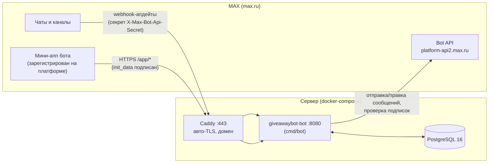
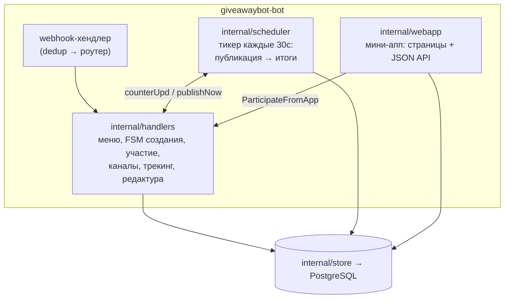

# Архитектура бота RandoMaster MAX

Как всё устроено — системно, с диаграммами. Подробная схема БД: [db.md](db.md).
Ключевые сценарии (жизненный цикл розыгрыша, участие, итоги, трекинг): [flows.md](flows.md).

## Обзор системы

Бот — один Go-бинарник (webhook-сервер + встроенный планировщик) + PostgreSQL +
Caddy (авто-TLS). Всё общение с MAX — через Bot API `platform-api2.max.ru`
(сертификат Минцифры встроен в бинарник, `SSL_CERT_FILE` не нужен).

Внутри одного процесса живут три подсистемы:

| Пакет | Ответственность |
|---|---|
| `cmd/bot` | сборка всего: конфиг, миграции, webhook, планировщик, HTTP-роуты |
| `internal/maxapi` | обёртка над официальным SDK: rate-limit 30 rps, метрики, `IsSubscriber`, `IsBotAdminInChat` |
| `internal/handlers` | вся логика диалогов: меню, FSM создания (18 шагов), участие + капча, «Мои каналы», редактура, аналитика/трекинг |
| `internal/fsm` | конечный автомат создания розыгрыша: порядок шагов, условные пропуски, Назад/Далее, валидация при Принять |
| `internal/scheduler` | публикация scheduled→active и итоги active→finished; атомарный claim (промежуточные статусы `publishing`/`finishing`), откат зависших, проверка отписок |
| `internal/webapp` | мини-апп: статика (`index/participate/results/help`) + API (`/app/api/*`) с авторизацией init_data (HMAC) |
| `internal/store` | PostgreSQL (pgx/v5), миграции в бинарнике (`go:embed`), идемпотентные записи |
| `internal/draw` | взвешенный выбор победителей по билетам (детерминированный, тестируемый) |
| `internal/captcha` | генерация PNG-капч в памяти (чат: ключ `user_id`; мини-апп: ключ `user_id:giveaway_id`) |
| `internal/subscription` | проверка подписок: `GET /chats/{id}/members?user_ids=` |
| `internal/dedup` | защита от дублей webhook-ретраев MAX (TTL-таблица в памяти) |

## Ключевые внешние механики MAX, на которых всё держится

| Механика | Где используется |
|---|---|
| Webhook (только 443 + сертификат доверенного CA) | единственный способ приёма апдейтов |
| `bot_started` / `bot_stopped` | право бота писать юзеру (флаг `users.flag_in_base`), payload диплинков `?start=` |
| `message_callback` + `PUT /messages` (правка ≤2/с на чат) | все меню и FSM; счётчик «Участвовать (N)» |
| startapp-ссылка `max.ru/<bot>?startapp=<param>` | открытие мини-аппа БЕЗ чата бота: участие (`part_<id>`), итоги (`results_<id>`), трекинг (`u_<code>`) — init_data несёт подписанный `user_id` |
| `GET /chats/{chatId}/members?user_ids=` | проверка подписок участников и админства бота |
| `bot_added` / `bot_removed` | авто-флаг `channels.is_bot_admin` |
| `user_added` / `user_removed` | атрибуция подписок по UTM, учёт отписок |

## Развёртывание и обновление

- Прод: `docker-compose.prod.yml` (postgres + bot + caddy), миграции — при старте бота (`DB_MIGRATE=true`).
- Деплой: push в ветку `speedup-develop` на сервере → git-хук сам пересобирает и перезапускает стек (см. `scripts/update.sh`, лог `/root/deploy.log`).
- Здоровье: `GET /healthz`, версия: `GET /version`, метрики RPS: `GET /metrics`.
