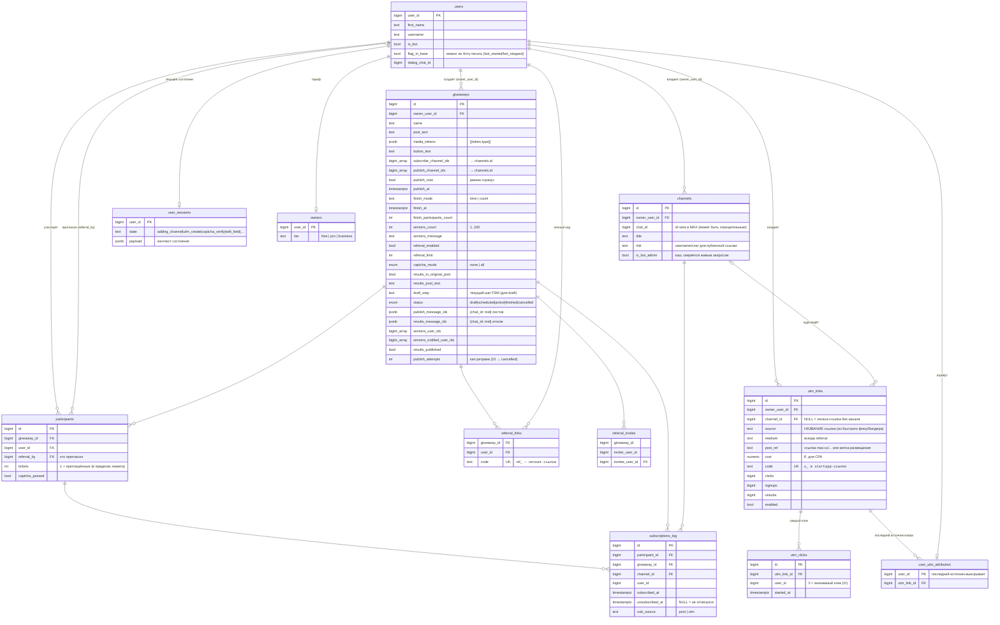
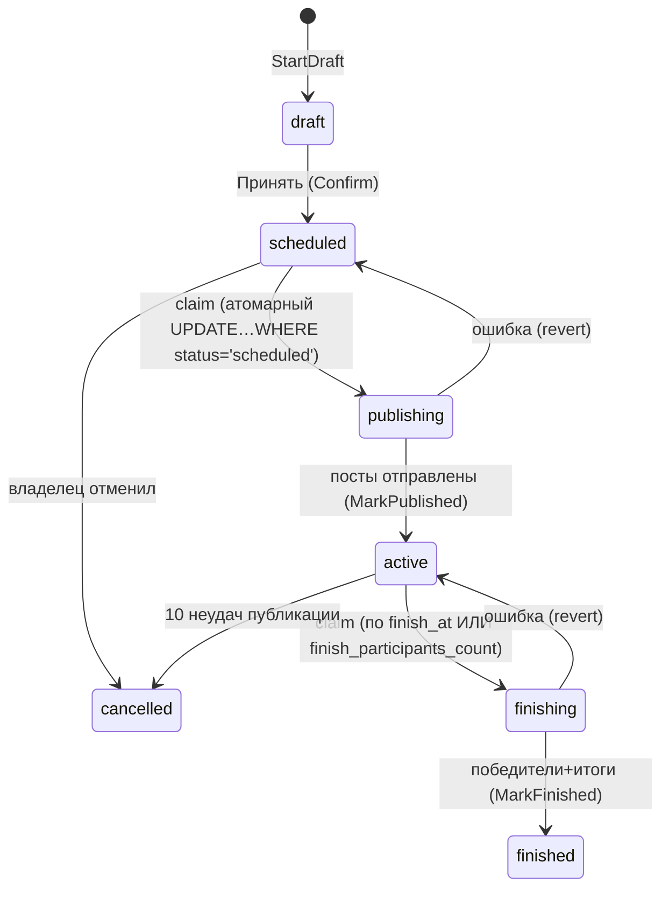

# База данных: схема и как всё DB-wise работает

PostgreSQL 16 (pgx/v5), миграции встроены в бинарник (`internal/store/migrations/`, `go:embed`), применяются автоматически при старте (`DB_MIGRATE=true`). Идемпотентны (`IF NOT EXISTS` / `ADD COLUMN IF NOT EXISTS`).

## ER-диаграмма (все таблицы)

`feature_limits` (справочник лимитов по тарифам: `tier`, `feature_key`, `limit_value`; `-1`=безлимит) — без FK, каркас под буд. платные функции.

## Почему схема такая

- **Всё в одной БД,FK на `users`** — ТЗ: «все пользователи попадают в базу бота». Юзер появляется из любого события: webhook-апдейт, участие, клик по трекинг-ссылке (мини-апп upsert'ит до записи клика — иначе FK `user_utm_attribution → users` молча откатывал бы клик).
- **Каналы — словарь владельца** (`owner_user_id` + `chat_id`): один канал могут добавить несколько организаторов; `is_bot_admin` — кэш, живой запрос `IsBotAdminInChat` перепроверяет его в критичных местах (шаг публикации, `/refresh`).
- **Каналы в розыгрыше — `bigint[]`, не join-таблица**: список выбирается пикером и правится атомарно одной колонкой. Денормализация осознанная (KISS): каналов в розыгрыше ≤ десятков.
- **`giveaways.publish_message_ids` / `results_message_ids` (jsonb `{chat_id: mid}`)** — идемпотентность публикации: краш между отправкой поста и сменой статуса не дублирует пост при перезапуске.
- **`participants` — единственное место, где живёт участие**; `ON CONFLICT DO NOTHING` даёт идемпотентность повторных кликов. Билеты (`tickets`) — основа взвешенной жеребьёвки.
- **`subscriptions_log.unsubscribed_at NULL = «не отписался»** — прямой ответ на требование ТЗ «через сколько отписался (если нет — nan)»; тикер `CheckUnsubs` обновляет колонку живыми проверками.
- **`user_sessions` — только НЕ-FSM состояния** (добавление канала, билдер ссылок, капча-верификация, редактура поля). Самwizard создания розыгрыша хранится в самой строке `giveaways` (`status='draft'`, `draft_step`) — черновик переживает рестарт и продолжается с того же шага.

## Жизненный цикл статусов розыгрыша (как БД гарантирует «ровно один раз»)

Атомарный claim (`UPDATE giveaways SET status='publishing' WHERE id=$1 AND status='scheduled'`) — двойной тик планировщика или параллельный cron-процесс не переотправят пост. Зависший в `publishing/finishing` дольше 5 минут розыгрыш откатывается (`recoverStale`). После выбора победителей (`winners_user_ids`) шаги идемпотентны по флагам: `winners_notified_user_ids` (кому ушло ЛС), `results_published` (вышли ли итоги).

## Как каждая функция трогает таблицы

| Функция | Читает | Пишет |
|---|---|---|
| Создание розыгрыша (FSM) | `channels`, `user_sessions` | `giveaways` (одна строка-черновик, `draft_step`), `user_sessions` |
| Участие (мини-апп/чат) | `giveaways`, `participants`, `subscriptions_log` | `participants` (+`tickets` при реферальном кредите), `subscriptions_log`, `referral_invites` |
| Итоги | `participants` (verified), `winners_*` | `giveaways` (winners, results_published, статусы) |
| Трекинг-клик | `utm_links` | `users` (upsert), `utm_clicks`, `utm_links.clicks`, `user_utm_attribution` |
| Подписка в канале | `user_utm_attribution` | `utm_links.signups`, `subscriptions_log`, `utm_subscribers` (retention) |
| Отписка | `user_utm_attribution` | `utm_links.unsubs`, `subscriptions_log.unsubscribed_at`, `utm_subscribers.unsubscribed_at`, `giveaway`-дисквалификация |
| Суточный поллинг удержания | `user_utm_attribution` × `utm_subscribers` | `utm_subscribers` (добавление уже-состоящих, фиксация тихих отписок) |
| Рефералка | `referral_links`, `referral_invites` | `referral_links`, `referral_invites`, `participants.tickets` |
| Редактура | `giveaways` | `giveaways` (точечные колонки, live-обновление постов) |
| Аналитика/CSV | `participants`, `subscriptions_log`, `utm_links`, `utm_clicks` | — |

## Индексы (что и почему)

| Индекс | Зачем |
|---|---|
| `giveaways (owner_user_id, status)` | списки «Мои розыгрыши» по фильтру |
| `giveaways (status, publish_at) WHERE status='scheduled'` | тикер публикации — только наставшие |
| `giveaways (status, finish_at) WHERE status='active'` | тикер итогов |
| `giveaways (status) WHERE finish_mode='count' AND finish_participants_count>0` | розыгрыши «по количеству участников» |
| `giveaways (updated_at) WHERE status IN ('publishing','finishing')` | откат зависших захвата (два частичных индекса) |
| `participants (giveaway_id)` / `(user_id)` | счётчик кнопки, «Мои участия», жеребьёвка |
| `subscriptions_log (user_id)`, `(channel_id)` | проверка отписок, динамика канала |
| `utm_links (owner_user_id)`, `(channel_id)`; `utm_clicks (utm_link_id)`, `(user_id)` | статистика и атрибуция |
