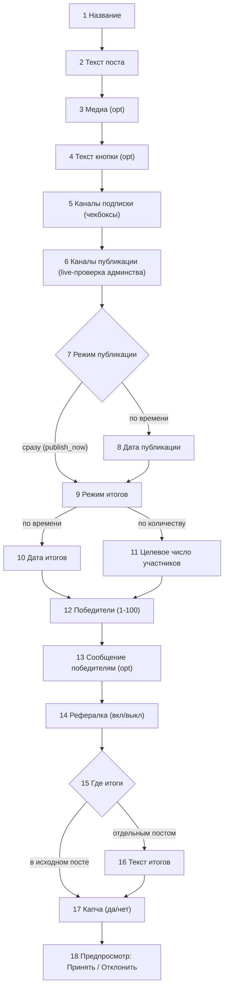
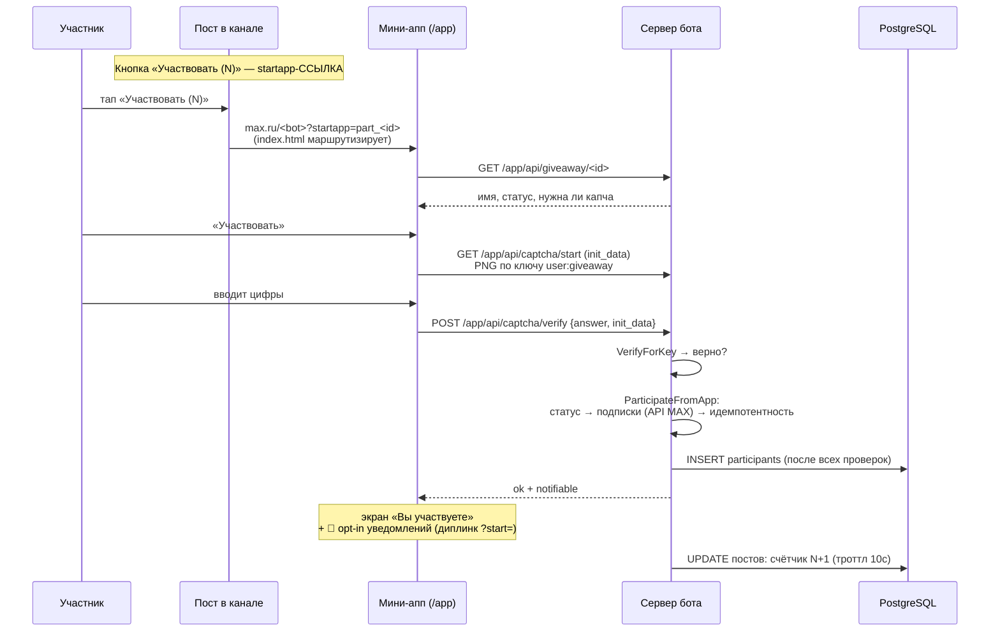
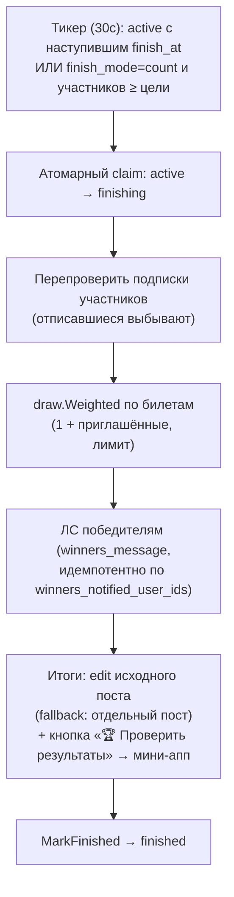
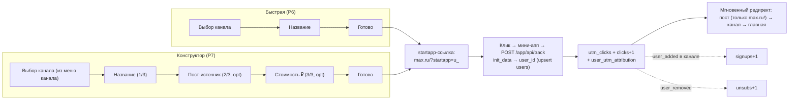

# Ключевые сценарии: как всё работает

## 1. Создание розыгрыша (FSM, 18 шагов)

Состояние — сама строка `giveaways` (`status='draft'`, `draft_step`): черновик
переживает рестарт, «Продолжить создание» возвращается к тому же шагу.

- На каждом шаге: `← Назад` (пропускает неактуальные условные шаги — режимы
  взаимно исключают шаги дат), `✖ Отменить` (с названием — в черновики,
  без — удаляется), `💡`-подсказка.
- «Опубликовать сразу» ≠ дата в прошлом: флаг `publish_now`, дата ставится
  в `now` только в момент «Принять» (не протухает, пока юзер идёт дальше).
  Переключение режима после «Назад» сбрасывает флаг — откат работает.
- Шаг 6 перед переходом проверяет админство бота ЖИВЫМ API-запросом
  (кэш `is_bot_admin` может протухнуть после смены токена/кика).
- «Принять» → полная валидация → `scheduled` (или немедленная публикация).

## 2. Участие (два пути, обе регистрируют только после всех проверок)

Fallback-путь (старые посты с callback-кнопкой / имя бота ещё не узнали):
callback `part:<id>` → проверка подписок → капча PNG картинкой в чат →
ответ сообщением → регистрация. Регистрация до верного ответа невозможна
(см. `TestParticipate_CaptchaGatesRegistration`).

Анонимный посетитель без диалога с ботом всё равно попадает в `users`
(init_data мини-аппа подписан) — upsert до любой записи.

## 3. Итоги

«Доп. победитель» у finished — тот же взвешенный выбор среди невыигравших +
уведомление + отдельный пост в каналы.

## 4. Трекинг-ссылки (аналитика источников)

Два флоу (быстрый и конструктор), оба начинают с выбора канала из «Мои каналы»:

- Весь трафик прогоняется через мини-апп — юзер попадает в БД бота без
  открытия диалога; подписка/отписка атрибутируются вебхуками канала.
- `/r/<code>` (302-редирект) — альтернатива без мини-аппа: клик анонимный.
- Open-redirect запрещён: редирект только на `https://max.ru/...`.
- Статистика: клики/подписки/отписки/конверсия/CPA + CSV-выгрузка.

## 5. Реферальная система

1. Участник при регистрации (рефералка включена) получает личный код
   (`referral_links`), ссылка `max.ru/<bot>/start/ref_<code>` в чате.
2. Друг приходит по ссылке → `bot_started(payload=ref_<code>)` →
   `referral_invites` (кто кого пригласил).
3. Друг проходит все проверки и становится участником → `ReferralCreditIfNeeded`:
   +1 билет пригласившему (в пределах `referral_limit`), уведомление инвайтеру.
4. Жеребьёвка взвешена по билетам; один человек выигрывает не больше раза.

## 6. Обновление на сервере (для QA)

push в `speedup-develop` (remote `vps`) → git-хук на сервере сам:
`docker compose up -d --build` → healthz-проверка. Лог: `/root/deploy.log`,
смотреть: `make logs` (бот) или `ssh root@155.212.168.147 'tail -30 /root/deploy.log'`.
